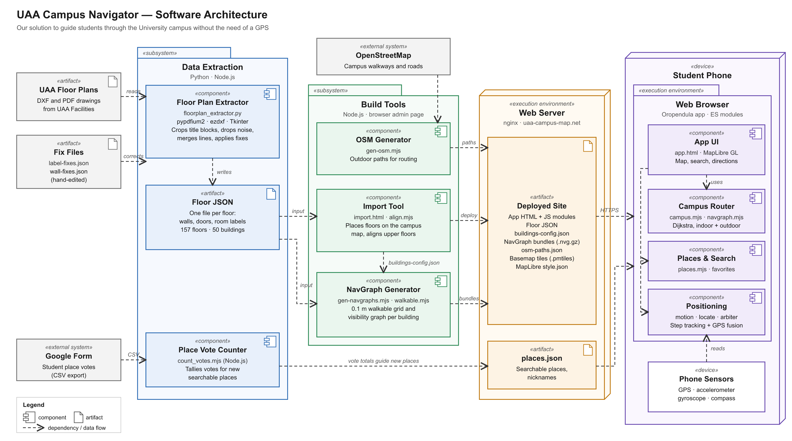

# UAA Campus Navigator

Our solution to guide students through the University campus without the need of a GPS.

Live site: https://uaa-campus-map.net

## Introduction

UAA's main campus is a network of buildings joined by skybridges and shared hallways. New students, visitors and anyone looking for an unfamiliar classroom struggle to find their way across it. Phone map apps stop at the front door, GPS is unreliable indoors, and the only detailed floor plans are CAD drawings made for facilities staff.

UAA Campus Navigator closes that gap. We turned UAA Facilities floor plans into machine-readable maps and built a web app that routes a student from one room to another. Routes follow hallways, stairs, elevators, skybridges and outdoor walkways. Indoors, the app tracks the student's position from the phone's own motion sensors (step counting and compass) instead of GPS. Outdoors, it blends in GPS when a signal is available.

The app runs in a phone browser with nothing to install. Today, 157 floor plans from 50 buildings have been extracted, and 26 buildings (79 floors) are live in the app.

### Goals

- Turn every public UAA floor plan into data an app can use
- Route a student from any room to any other, indoors and out
- Show where the student is, even where GPS cannot reach
- Run in a phone browser with nothing to install

## Architecture

The system is a pipeline of four parts. Data moves left to right in the diagram.

### 1. Data extraction (`Data Extraction/`, `Place Votes/`)

- **Floor plan extractor** (`floorplan_extractor.py`, Python): reads UAA Facilities floor plans. It reads PDFs with pypdfium2 and DXF drawings with ezdxf, and you can run it from a Tkinter window or the command line.
  - It writes an SVG and a JSON file per floor with walls, doors and room labels, tagged with the building code, name and level.
  - It crops off title blocks and sheet borders, drops hatching and dashed-line noise, and merges line segments.
  - It applies hand-edited corrections from `label-fixes.json` (mislabeled rooms) and `wall-fixes.json` (walls missing from the drawings).
  - Its output is in `Floor Data/`: 157 floors across 50 buildings.
- **Place vote counter** (`Place Votes/count_votes.mjs`, Node.js): counts votes from the place-nickname Google Form CSV export.
  - It allows one vote per UAA email per name and checks building codes against the extractor's building table.
  - It writes `shortlist.json` with draft entries. An admin then reviews the names and adds them in `places.html`.
- **Georeferencing** (`Data Extraction/georef/`): an accuracy experiment that is now on hold. The app does not use its output.

### 2. Build tools (`Oropendula/src/`)

- **Import tool** (`import.html`, `align.mjs`): places each floor on the campus map and aligns upper floors to the ground floor. It saves the result to `buildings-config.json`.
- **NavGraph generator** (`gen-navgraphs.mjs`, `walkable.mjs`):
  - It floods each floor from outside to find the indoor walkable area.
  - It builds a 0.1 m clearance grid and a visibility graph.
  - It packs each building into one compressed `.nvg.gz` bundle. Hashes let the app reject a bundle that no longer matches its floor JSON.
- **OSM generator** (`gen-osm.mjs`): converts OpenStreetMap walkways and roads into `osm-paths.json` for outdoor legs.
- **Smoke tests** (`node smoke.mjs`): must pass before deploying.

### 3. Web server

nginx serves the app at uaa-campus-map.net as a static site, with no backend and no database. Along with the app it serves:

- the floor JSON
- `buildings-config.json`
- the graph bundles
- outdoor paths
- `places.json`
- the MapLibre style and the PMTiles basemap

### 4. Web app: Oropendula, in the phone's browser

The app is plain JavaScript ES modules with no build step and no npm dependencies, drawn with MapLibre GL.

- **App UI** (`app.html`): the map, floor switching, search and directions.
- **Campus router** (`navgraph.mjs`, `campus.mjs`, `roompin.mjs`, `osm.mjs`):
  - It finds the shortest path on each floor with Dijkstra's algorithm.
  - A tiered router joins floors and buildings through doors, stairs, elevators and skybridges, and connects them to outdoor paths.
  - Room pin (`roompin.mjs`) finds the door of a specific room, so a route can lead right to it.
- **Positioning** (`motion.mjs`, `magnetometer.mjs`, `headingfield.mjs`, `locate.mjs`, `arbiter.mjs`, `autocal.mjs`):
  - It detects steps, blends compass and gyroscope readings into a heading, and ignores the compass near magnetic disturbances.
  - It snaps the heading to the directions the hallways allow.
  - A particle filter keeps the position on walkable floor.
  - Outdoors, it blends with GPS and calibrates the student's step length.
- **Places** (`places.mjs`, `places.json`): room search with nicknames (for example "Subway" in the Student Union) and student favorites.

## Technologies

| Area | Tools |
| --- | --- |
| Data extraction | Python, pypdfium2, ezdxf, Tkinter |
| Web app | JavaScript ES modules (no build step), MapLibre GL, PMTiles |
| Map data | UAA Facilities floor plans, OpenStreetMap |
| Build and test | Node.js scripts, `node smoke.mjs` |
| Hosting | nginx static site |
| Collaboration | Git, GitHub (UAA-Campus-Map organization), pull requests |

## Repository layout

| Path | What it holds |
| --- | --- |
| `Data Extraction/` | Floor plan extractor, fix files, source plans, extracted floor JSON ([README](Data%20Extraction/README.md)) |
| `Data Extraction/georef/` | Georeferencing experiment, on hold ([README](Data%20Extraction/georef/README.md)) |
| `Place Votes/` | Vote counter (`count_votes.mjs`), form responses, place shortlist |
| `Oropendula/` | The web app, as a Git submodule ([README](Oropendula/src/README.md), [module docs](Oropendula/docs/README.md)) |
| `Diagrams/` | Architecture diagrams: full (`architecture-diagram`) and overview (`architecture-overview`), as PNG and SVG |
| `TODO.md` | Project status and next steps |
